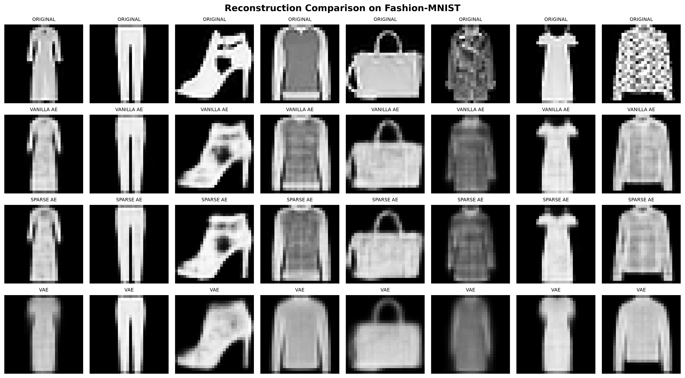
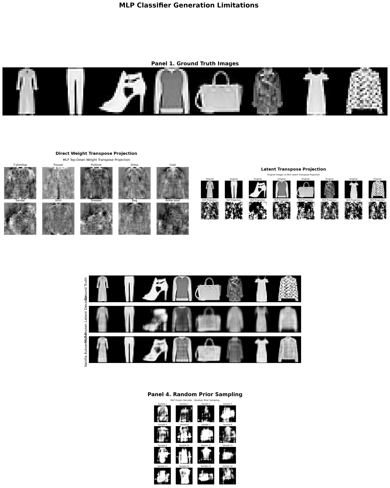

# Comparative Study of Generative Models on Fashion-MNIST

## Overview

This project presents an experimental comparison of six generative models using the Fashion-MNIST dataset. The experiments investigate how different architectures learn image representations, reconstruct images, generate new samples, and perform under different evaluation metrics.

The project also explores the limitations of an MLP Classifier for image generation through weight transpose projection, frozen latent decoder, and random prior sampling experiments.

The main focus is to compare reconstruction fidelity, generative quality, latent space behavior, training stability, and inference efficiency across different model architectures.

## Repository Structure

### Notebooks
- `00_setup.ipynb`: Environment setup and initial configuration.
- `01_dataset_preparation.ipynb`: Dataset preparation and preprocessing.
- `02_mlp_classifier.ipynb`: MLP Classifier training and generation limitation experiments.
- `03_vanilla_autoencoder.ipynb`: Vanilla Autoencoder training, reconstruction, and evaluation.
- `04_sparse_autoencoder.ipynb`: Sparse Autoencoder implementation and evaluation.
- `05_vae.ipynb`: Variational Autoencoder training and image generation.
- `06_vanilla_gan.ipynb`: Vanilla GAN implementation and training.
- `07_dcgan.ipynb`: Deep Convolutional GAN implementation and training.
- `08_ddpm.ipynb`: DDPM training, fine-tuning, and image generation.
- `09_evaluation_visualization.ipynb`: Model evaluation, metric comparison, and result visualization.

### Checkpoints
- `checkpoints/`: Saved model weights used for evaluation, reconstruction, and image generation, including AE, Sparse AE, VAE, GAN, DCGAN, DDPM, and MLP Classifier checkpoints.

### Data
- `data/`: Dataset-related files.
- `DDPM_Complete_Original/`: Additional DDPM-related resources.
- `torch_cache/`: Cached files used during experimentation.
- `temp/`: Temporary files generated during experimentation.

### Results
- `results/`: Generated images, reconstruction comparisons, interpolation visualizations, training curves, and evaluation results.

### Configuration and Dependencies
- `config.json`: Project configuration.
- `requirements.txt`: Python dependencies.
- `.gitignore`: Specifies files and directories excluded from Git tracking.
- `README.md`: Project documentation.

## Models

Six generative models were implemented and evaluated:

Vanilla Autoencoder (AE): Learns image reconstruction through an encoder-decoder architecture. 
Sparse Autoencoder (Sparse AE): Introduces sparsity regularization to encourage more selective latent representations. 
Variational Autoencoder (VAE): Learns a probabilistic latent space using reconstruction loss and KL divergence. 
Vanilla GAN: Uses a generator and discriminator with fully connected layers to generate images. 
Deep Convolutional GAN (DCGAN): Uses convolutional architectures to learn spatial image features and generate images. 
Denoising Diffusion Probabilistic Model (DDPM): Generates images through an iterative denoising process. 

## Dataset

Fashion-MNIST is used as the primary dataset. It contains grayscale images of clothing items with a resolution of 28 × 28 pixels across 10 categories.

The dataset is used for model training, validation, reconstruction evaluation, random generation, and latent space interpolation.

## Experimental Objectives

The experiments are conducted to:

- Compare reconstruction quality between Vanilla AE, Sparse AE, and VAE.
- Evaluate image generation quality using VAE, Vanilla GAN, DCGAN, and DDPM.
- Analyze training behavior and stability across different architectures.
- Explore latent space interpolation and the continuity of generated samples.
- Investigate the limitations of MLP Classifier representations for image generation.
- Compare model performance based on reconstruction metrics, generative quality, and inference latency.

## Quantitative Results

### Reconstruction Performance

Vanilla AE, Sparse AE, and VAE are evaluated based on their image reconstruction performance.

| Model | MSE ↓ | PSNR (dB) ↑ | SSIM ↑ |
|---|---:|---:|---:|
| Vanilla AE | 0.006143 | 23.3536 | 0.8367 |
| Sparse AE | 0.006198 | 23.3206 | 0.8353 |
| VAE | 0.019956 | 17.6005 | 0.6273 |

Vanilla AE achieved the best reconstruction performance, with the lowest MSE and highest PSNR and SSIM. Sparse AE produced comparable results, while VAE generated smoother and blurrier reconstructions due to its probabilistic latent space regularization.

### Generative Performance

| Model | FID ↓ | Inference Latency (Batch 64) |
|---|---:|---:|
| VAE | 153.0886 | 0.92610 ms |
| Vanilla GAN | 213.9064 | 0.88210 ms |
| DCGAN | 107.4314 | 2.59628 ms |
| DDPM | 126.3215 | 198.40812 s |

DCGAN achieved the lowest FID among the evaluated generative models. Vanilla GAN had the lowest inference latency, while DDPM required significantly longer generation time due to its iterative denoising process.

## Visual Results

### 1. Image Reconstruction

Comparison of original Fashion-MNIST images and their reconstructions using Vanilla AE, Sparse AE, and VAE.

Vanilla AE and Sparse AE preserved image structures relatively well. VAE produced smoother reconstructions with less clearly defined details.

### 2. Random Image Generation

Generated samples from VAE, Vanilla GAN, DCGAN, and DDPM using random sampling.

DCGAN produced the most recognizable clothing shapes among the evaluated generative models. VAE generated recognizable but blurry samples, while Vanilla GAN and DDPM still showed coarse or pixelated patterns.

### 3. MLP Classifier Generation Limitations

Experiments investigating the use of MLP Classifier weights and latent features for image generation.

The experiments include:

- Direct weight transpose projection.
- Latent weight transpose projection.
- Frozen latent decoder reconstruction.
- Random prior sampling.

Direct transpose projections produced unstructured images. The frozen decoder improved reconstruction but remained below Vanilla AE, while random prior sampling generated inconsistent and distorted samples.

### 4. Latent Space Interpolation

Comparison of linear interpolation between two latent vectors across Vanilla AE, Sparse AE, VAE, Vanilla GAN, and DCGAN.

The interpolation experiments showed different transition behaviors across architectures. Vanilla AE, Sparse AE, and VAE demonstrated gradual transitions between clothing shapes, while Vanilla GAN and DCGAN produced less consistent transitions.

### 5. Training Curves and DDPM Reverse Diffusion

Training and validation loss curves for the six generative models, alongside the DDPM reverse diffusion trajectory.

The experiments show different training behaviors depending on the model architecture. Autoencoder-based models demonstrated decreasing reconstruction losses, while GAN models showed different generator and discriminator loss patterns. DDPM was initially trained for 50 epochs and subsequently fine-tuned for 10 additional epochs from the previous checkpoint.

## MLP Classifier Investigation

An MLP Classifier was trained to classify Fashion-MNIST images and its latent representation was investigated for image generation.

### Image Reconstruction Comparison

| Method | MSE ↓ | PSNR (dB) ↑ | SSIM ↑ |
|---|---:|---:|---:|
| MLP Frozen Decoder | 0.020743 | 17.6719 | 0.6311 |
| Vanilla AE | 0.006143 | 23.3536 | 0.8367 |

The frozen latent decoder improved image reconstruction compared with direct weight transpose projections. However, its performance remained below Vanilla AE.

These experiments demonstrate that classification-oriented representations are not optimized for preserving all visual information required for image reconstruction and generation.

## Key Findings

- **Reconstruction:** Vanilla AE achieved the best reconstruction performance based on MSE, PSNR, and SSIM.
- **Sparsity:** Sparse AE produced results comparable to Vanilla AE, with slightly higher reconstruction error.
- **Generative Quality:** DCGAN achieved the lowest FID among the evaluated generative models.
- **Inference Efficiency:** Vanilla GAN had the lowest measured inference latency, while DDPM required substantially longer due to iterative denoising.
- **Latent Space:** Interpolation behavior differed across architectures, reflecting differences in latent space representation and regularization.
- **MLP Limitations:** MLP Classifier weights and latent features were not directly suitable for image generation. A separate frozen decoder improved reconstruction but remained below Vanilla AE.

## Conclusion

This project provides an experimental comparison of different generative model architectures on Fashion-MNIST, highlighting their differences in reconstruction fidelity, image generation quality, latent space behavior, training stability, and inference efficiency.

Vanilla AE performed best in image reconstruction, while DCGAN achieved the lowest FID among the evaluated generative models. Vanilla GAN offered the lowest measured inference latency, whereas DDPM required substantially longer generation time due to iterative denoising.

The MLP Classifier investigation further demonstrated that classification-oriented representations are not inherently suitable for image generation, as they do not preserve all visual information or provide a regularized latent distribution for sampling.

The results highlight the importance of selecting generative architectures based on the specific requirements of reconstruction, generation quality, computational efficiency, and latent space structure.